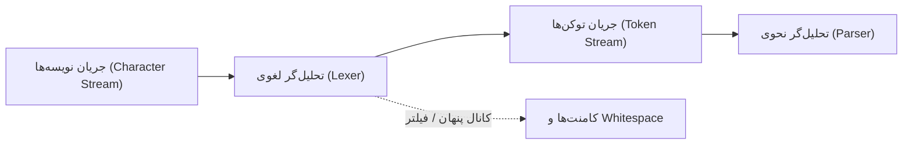

# ۱. مبانی Lexical Analysis و Tokenization {#sec-intro}

فرآیند lexical analysis (تحلیل لغوی) که با عناوینی چون scanning یا tokenization نیز شناخته می‌شود، وظیفه دارد کاراکترهای خام متن منبع را به نمادهای معنادار با هویت نحوی مشخص دسته‌بندی نماید.

<definition title="مفهوم Token و Lexeme" id="def-token">

* **lexeme (لکسم):** رشتهٔ نویسه‌ای واقعی درون متن ورودی است که با یک الگوی معین تطابق می‌یابد (مانند رشتهٔ `"128"` یا کلمهٔ `"while"`).
* **token (توکن):** شیء انتزاعی تولیدشده توسط lexer است که دربرگیرندهٔ مشخصات نوع نمادین (type)، متن واقعی (text)، شماره سطر (line)، موقعیت در سطر (charPositionInLine) و کانال انتقال (channel) می‌باشد.

</definition>



<mybox type="info">

در خط لولهٔ کامپایلر، lexer به طور مستقل کار نمی‌کند، بلکه به عنوان یک تأمین‌کنندهٔ تقاضامحور (demand-driven) توکن‌ها را تک‌به‌تک و بر اساس فراخوانی متد `nextToken()` در اختیار parser قرار می‌دهد.

</mybox>

---

# ۲. ساختار فایل Lexer Grammar در <en>ANTLR4</en> {#sec-lexer-grammar}

در <en>ANTLR4</en>، قواعد لکسر می‌توانند در یک گرامر ترکیبی یا به صورت یک **فایل مجزا با نام `lexer grammar`** تعریف شوند. تفکیک lexer از parser قابلیت reusability (استفادهٔ مجدد) را افزایش داده و امکان استفاده از ویژگی‌های پیشرفته مانند lexer modes را فراهم می‌کند.

## ۲–۱ نام‌گذاری فایل و Header

فایل گرامر باید دارای پسوند `.g4` باشد و نام آن با شناسهٔ اعلام‌شده در فایل کاملاً مطابقت داشته باشد:

```antlr
lexer grammar TemplateLexer;

// قواعد لکسر در ادامه تعریف می‌شوند...
```

<mybox type="warning">

در <en>ANTLR4</en>، تمام نام‌های قواعد لکسر (token names) **حتماً و الزاماً باید با حرف بزرگ انگلیسی (uppercase)** آغاز شوند (مانند `ID`, `INT`, `PLUS`). قواعدی که با حرف کوچک آغاز شوند توسط <en>ANTLR4</en> به عنوان parser rule تلقی شده و منجر به خطای کامپایل خواهند شد.

</mybox>

## ۲–۲ ترتیب Keywords، نمادها و Identifiers

کلمات کلیدی یا keywords که ممکن است با فرمول کلی identifiers (شناسه‌ها) هم‌پوشانی داشته باشند، حتماً باید **پیش از قاعدهٔ `ID`** تعریف شوند:

```antlr
// ۱. کلمات کلیدی رزروشده (Keywords)
IF      : 'if' ;
ELSE    : 'else' ;
WHILE   : 'while' ;
INT_TYPE: 'int' ;

// ۲. عملگرها و نمادها (Operators & Punctuation)
ASSIGN  : '=' ;
PLUS    : '+' ;
MINUS   : '-' ;
SEMI    : ';' ;
LPAR    : '(' ;
RPAR    : ')' ;

// ۳. شناسه‌ها (Identifiers)
ID      : [a-zA-Z_] [a-zA-Z0-9_]* ;

// ۴. مقادیر تحت‌اللفظی و ثابت (Literals)
INT_VAL : [0-9]+ ;
STRING  : '"' (~["\\\r\n] | '\\' .)* '"' ;
```

---

# ۳. قوانین تطابق و اولویت (Matching Precedence) {#sec-precedence}

هنگامی که چندین قاعدهٔ lexer می‌توانند با متن ورودی همخوانی داشته باشند، <en>ANTLR4</en> بر اساس دو قانون تصمیم‌گیری می‌کند:

<theorem title="اصول تطابق در لکسر <en>ANTLR4</en>" id="thm-precedence">

1. **قانون Longest Match (که Maximal Munch نیز نامیده می‌شود):**
   لکسر همواره قاعده‌ای را انتخاب می‌کند که بیشترین تعداد نویسه از ورودی را مصرف و تطابق دهد.
2. **قانون First Rule Defined Wins (تقدم ترتیب تعریف):**
   اگر دو قاعده بتوانند تعداد کاراکترهای کاملاً یکسانی را تطابق دهند، قاعده‌ای که در متن گرامر **بالاتر تعریف شده باشد** اولویت خواهد داشت.

</theorem>

<example title="رقابت میان Keyword و Identifier">

اگر ورودی برنامه کلمهٔ `while` باشد:
* قاعدهٔ `WHILE : 'while';` تعداد ۵ نویسه را تطابق می‌دهد.
* قاعدهٔ `ID : [a-zA-Z_]+;` نیز ۵ نویسه را تطابق می‌دهد.

به دلیل قانون تقدم ترتیب تعریف، چون `WHILE` بالاتر نوشته شده است، توکن `WHILE` صادر می‌شود. اما اگر ورودی `whileCounter` باشد، قاعدهٔ `WHILE` تنها ۵ کاراکتر ولی `ID` کل ۱۲ کاراکتر را پوشش می‌دهد؛ طبق قانون longest match، بدون توجه به ترتیب قرارگیری، توکن `ID` برنده خواهد شد.

</example>

---

# ۴. قواعد Fragment (قطعات کمکی گرامر) {#sec-fragments}

قواعد `fragment` ابزاری مناسب برای ماژولار کردن regular expressions بدون تولید توکن اضافی در خروجی هستند.

<definition title="قاعده Fragment" id="def-fragment">

قاعده‌ای است با کلمه کلیدی `fragment` که به خودی خود هرگز تبدیل به یک توکن مستقل نمی‌شود و در token stream ظاهر نمی‌گردد؛ بلکه تنها به عنوان یک قطعهٔ سازنده در تعریف سایر توکن‌ها استفاده می‌شود.

</definition>

```antlr
// قطعات کمکی داخلی (Fragment Rules)
fragment DIGIT : [0-9] ;
fragment NON_ZERO_DIGIT : [1-9] ;
fragment HEX_DIGIT : [0-9a-fA-F] ;
fragment ESC_SEQ : '\\' [btnfr"'\\] ;

// توکن‌های اصلی خروجی (Tokens)
INTEGER_LITERAL : '0' | NON_ZERO_DIGIT DIGIT* ;
HEX_LITERAL     : '0' [xX] HEX_DIGIT+ ;
CHAR_LITERAL    : '\'' (~['\\\r\n] | ESC_SEQ) '\'' ;
```

<mybox type="success">

استفاده از `fragment` باعث تمیز ماندن vocabulary (واژگان زبان) و کاهش تعداد توکن‌های غیرضروری در جدول نمادهای parser می‌شود.

</mybox>

---

# ۵. دستورات Lexer و ارتباط آنها با Type Checking {#sec-actions}

دستورات لکسر پس از نماد `->` در پایان قاعده نوشته می‌شوند و رفتار موتور لکسر پس از تطابق را تنظیم می‌کنند.

## ۵–۱ نادیده‌گیری با دستور `skip`

برای بخش‌هایی از کد که اهمیتی در ساختار نحوی ندارند (نظیر whitespace یا کامنت‌ها)، از دستور `skip` استفاده می‌شود تا کاراکترها بدون ارسال به parser دور ریخته شوند:

```antlr
WHITE_SPACE   : [ \t\r\n]+ -> skip ;
LINE_COMMENT  : '//' ~[\r\n]* -> skip ;
BLOCK_COMMENT : '/*' .*? '*/' -> skip ;
```

## ۵–۲ کانال‌های توکن (Token Channels) و کاربردهای صنعتی آن

یک کامپایلر معمولی ممکن است کامنت‌ها را دور بریزد، اما ابزارهای مدرن مهندسی نرم‌افزار به تمام اجزای متن منبع نیاز دارند:

```antlr
channels {
    COMMENTS_CHANNEL,
    DIRECTIVE_CHANNEL,
    WHITESPACE_CHANNEL
}

BLOCK_COMMENT : '/*' .*? '*/' -> channel(COMMENTS_CHANNEL) ;
PREPROCESSOR  : '#' ~[\r\n]*  -> channel(DIRECTIVE_CHANNEL) ;
WS            : [ \t\r\n]+    -> channel(HIDDEN) ;
```

<mybox type="note">

کانال `HIDDEN` کانال از‌پیش‌تعریف‌شدهٔ <en>ANTLR4</en> است که parser به صورت خودکار آن را نادیده می‌گیرد، اما از طریق شیء `BufferedTokenStream` در جاوا به سادگی قابل بازیابی و پیمایش است.

</mybox>

## ۵–۳ دستور `type(...)` و نقش آن در فاز Type Checking

یکی از سوالات بنیادین این است: **آیا دستور `type(...)` در لکسر برای بررسی انواع (Type Checking) کاربرد دارد؟**

<mybox type="warning">

**مرز میان Lexer و Type Checker:**
تحلیل‌گر لغوی دید سراسری از متغیرها، دامنه‌ها (scopes) و اعلان‌ها ندارد؛ بنابراین **نمی‌تواند** خطای سازگاری عبارات (مثل جمع عدد با رشته در `x + "hello"`) را بررسی کند. این وظیفه اختصاصاً بر عهدهٔ فاز **semantic analysis (تحلیل معنایی)** روی درخت AST است.

</mybox>

با این حال، دستور `type(...)` نقشی حیاتی در **برچسب‌گذاری اولیه و استانداردسازی نوع توکن‌ها** ایفا می‌کند که مستقیماً فاز Type Checking بعدی را تسهیل و تسریع می‌نماید:

### ۱. یکپارچه‌سازی و نرمال‌سازی مقادیر ثابت (Literal Normalization)
در زبان‌های برنامه‌نویسی، اعداد صحیح می‌توانند به فرم‌های ده‌دهی، هگزادسیمال، باینری یا نماد علمی نوشته شوند. اگر هرکدام توکن مجزا تولید کنند، کدهای Type Checker در AST به شدت شلوغ و تکراری می‌شوند. با دستور `type(...)`، همه به یک نوع نمادین واحد نگاشت می‌گردند:

```antlr
DECIMAL_INT : [0-9]+                 -> type(INT_LITERAL) ;
HEX_INT     : '0' [xX] [0-9a-fA-F]+  -> type(INT_LITERAL) ;
BIN_INT     : '0' [bB] [01]+         -> type(INT_LITERAL) ;
OCTAL_INT   : '0' [oO] [0-7]+        -> type(INT_LITERAL) ;
```

**اثر در Type Checking:** در فاز بعدی، تحلیل‌گر معنایی فقط قاعدهٔ `INT_LITERAL` را بررسی می‌کند و نیازی نیست برای هر سیستم عددنویسی کد جداگانه‌ای جهت بررسی سازگاری نوع بنویسد.

### ۲. حل مسئلهٔ تمایز نام نوع از شناسه (The Typedef Problem)
در زبان‌هایی مثل C یا Go، ساختاری مثل `Point p;` مبهم است: آیا `Point` نام یک type است یا یک نام متغیر؟ با کمک دستور `type` و متدهای جاوا در لکسر، می‌توان نوع توکن را بر اساس جدول نمادها بازنویسی کرد:

```antlr
ID : [a-zA-Z_] [a-zA-Z0-9_]* {
    if (isTypeName(getText())) {
        setType(TYPE_NAME);
    }
} ;
```

### ۳. کلمات کلیدی حساس به زمینه (Contextual / Soft Keywords)
کلماتی مانند `var`, `get`, `set` یا `yield` در بعضی زبان‌ها هم می‌توانند کلمه کلیدی باشند و هم نام متغیر. با دستور `type(...)` می‌توان آنها را در بافت‌های ویژه بدون تداخل با شناسه‌های عمومی مدیریت نمود:

```antlr
GET_KW : 'get' -> type(GET) ;
SET_KW : 'set' -> type(SET) ;
```

---

# ۶. حالات پیشرفته لکسر (Lexer Modes & Island Grammars) {#sec-modes}

قابلیت lexer modes برای زبان‌هایی کاربرد دارد که ساختارهای نحوی متفاوتی را درون یکدیگر ترکیب می‌کنند (معروف به island grammars یا گرامرهای جزیره‌ای).

<remark title="محدودیت حالت‌ها در گرامرهای ترکیبی">

ویژگی `mode` **فقط و فقط در فایل‌های مستقل `lexer grammar`** پشتیبانی می‌شود و در گرامرهای ترکیبی (combined grammars) قابل استفاده نیست.

</remark>

## کاربرد عملی: پردازش عبارات درون رشته (String Interpolation)

در زبان‌های مدرن (نظیر Python, Kotlin, JavaScript)، برنامه‌نویسان می‌توانند عبارات محاسباتی واقعی را مستقیماً درون متن رشته‌ها قرار دهند؛ به عنوان مثال:
```python
f"Total is: {x + 1} dollars"
```

### چرا لکسر تک‌حالته معمولی در این سناریو با شکست مواجه می‌شود؟
1. **تضاد در تفسیر فاصله‌ها و کاراکترها:** در بخش متنی رشته (`Total is:` و ` dollars`)، کاراکترهای فاصله (`whitespace`) نباید نادیده گرفته یا دور ریخته شوند، بلکه دقیقاً جزئی از متن پیام هستند. علاوه بر این، کلمهٔ `Total` نباید به عنوان یک متغیر یا شناسهٔ برنامه شناخته شود.
2. **تفسیر ناگهانی کد محاسباتی در دل متن:** درست در وسط همین رشته، بلوک `{x + 1}` ظاهر می‌شود که یک عبارت محاسباتی زنده است! در اینجا `x` باید به عنوان توکن `ID`، علامت `+` به عنوان عملگر `PLUS` و عدد `1` به عنوان توکن `INT_VAL` شناسایی و به parser تحویل داده شوند.

یک لکسر تک‌حالته و تخت (flat lexer) نمی‌تواند همزمان دو رفتار متضاد را برای کاراکترها اِعمال کند؛ زیرا قواعد آن برای کل فایل یکسان است.

### حل مسئله با چرخهٔ تعویض حالت (Lexer Modes):
با استفاده از مکانیزم پشته‌ای حالات (`pushMode` و `popMode`) در <en>ANTLR4</en>، این چالش به سادگی حل می‌شود:

1. **شروع در حالت پیش‌فرض (`DEFAULT_MODE`):** لکسر در حال خواندن کدهای استاندارد برنامه است.
2. **ورود به رشته با `f"`:** دستور `pushMode(IN_INTERPOLATION)` اجرا می‌شود. لکسر قواعد عادی را کنار گذاشته و وارد حالت پردازش متن رشته می‌شود؛ در این حالت متن‌های خام به عنوان توکن‌های متنی (`TEXT_SEGMENT`) بدون حذف فاصله خوانده می‌شوند.
3. **مواجهه با `{`:** دستور `pushMode(DEFAULT_MODE)` اجرا می‌شود. لکسر موقتاً به حالت عادی کدنویسی برمی‌گردد تا متغیر `x`، عملگر `+` و عدد `1` را به عنوان توکن‌های واقعی کد پردازش کند.
4. **مواجهه با `}`:** دستور `popMode` لکسر را به حالت رشته برمی‌گرداند تا ادامه متن (` dollars`) خوانده شود.
5. **مواجهه با `"` پایانی:** اجرای مجدد `popMode` لکسر را به طور کامل از حالت رشته خارج کرده و به جریان اصلی برنامه بازمی‌گرداند.

```antlr
lexer grammar TemplateLexer;

// حالت پیش‌فرض (کدهای معمولی برنامه)
STRING_START : 'f"' -> pushMode(IN_INTERPOLATION) ;
ID           : [a-zA-Z_]+ ;
WS           : [ \t\r\n]+ -> skip ;

// ============================================
// حالت اختصاصی پردازش درون رشته
// ============================================
mode IN_INTERPOLATION;

STRING_END   : '"'  -> popMode ;
EXPR_OPEN    : '{'  -> pushMode(DEFAULT_MODE) ; // بازگشت موقت به لکسر کد برای عبارات
TEXT_SEGMENT : ~["{\\]+ ;
ESCAPE_SEQ   : '\\' . ;
```

<mybox type="success" icon="rocket">

فرمان‌های `pushMode` و `popMode` به صورت یک پشته (stack) کار می‌کنند و سطوح نامحدودی از تودرتویی میان کدهای برنامه و عبارات درون رشته را مدیریت می‌نمایند.

</mybox>

---

# ۷. متادیتا و الصاق داده به توکن‌ها (Custom Token Payloads) {#sec-payloads}

به طور پیش‌فرض، یک توکن فقط متن لغوی خام (`getText()`) را ذخیره می‌کند. برای افزایش کارایی در فازهای بعدی کامپایلر (مانند AST Building و Type Checking)، می‌توان با استفاده از یک `TokenFactory` اختصاصی در جاوا، مقدار تبدیل‌شدهٔ واقعی را مستقیماً به شیء توکن پیوست کرد:

```java
public class TypedToken extends CommonToken {
    // نگهداری مقدار محاسباتی واقعی و نوع داده
    public Object parsedValue;
    public PrimitiveType inferredType;

    public TypedToken(Pair<TokenSource, CharStream> source, int type, int channel, int start, int stop) {
        super(source, type, channel, start, stop);
    }
}
```

با این تکنیک، وقتی یک توکن عدد هگزادسیمال مثل `"0x1A"` خوانده می‌شود، لکسر می‌تواند مقدار صحیح `26` را مستقیماً در شیء توکن ذخیره کند تا در فاز AST و Type Checking نیازی به پارس کردن دوبارهٔ رشته نباشد.

---

# ۸. مدیریت Lexical Errors و کاراکترهای ناشناخته {#sec-errors}

اگر متنی در ورودی قرار گیرد که با هیچ قاعده‌ای همخوانی نداشته باشد، لکسر به طور پیش‌فرض پیام خطای زیر را صادر می‌کند:
`line X:Y token recognition error at: '...'`

برای مدیریت بهتر خطاها در سطح برنامه، قرار دادن یک catch-all rule (قاعدهٔ پوشش همگانی) در انتهای فایل توصیه می‌شود:

```antlr
// آخرین قاعده در فایل لکسر:
UNKNOWN : . ;
```

مزایای این روش:
1. کاراکتر نامعتبر به عنوان توکنی از نوع `UNKNOWN` بسته‌بندی می‌شود.
2. اجرای برنامه متوقف نشده و کد جاوا می‌تواند پیام خطای اختصاصی به همراه شماره خط و ستون را گزارش نماید.

---

<pagebreak>

# ۹. اجرای عملی و Integration در جاوا و VS Code {#sec-usage}

## ۹–۱ کد راه‌اندازی و خواندن توکن‌ها در جاوا

```java
import org.antlr.v4.runtime.*;

public class LexerRunner {
    public static void main(String[] args) throws Exception {
        String code = "int total = 100 + 45;";
        
        // ۱. تبدیل رشته به CharStream
        CharStream stream = CharStreams.fromString(code);
        
        // ۲. ساخت شیء Lexer
        TemplateLexer lexer = new TemplateLexer(stream);
        
        // ۳. پیمایش Token Stream تا انتهای فایل
        Token token;
        while ((token = lexer.nextToken()).getType() != Token.EOF) {
            String ruleName = TemplateLexer.VOCABULARY.getSymbolicName(token.getType());
            System.out.printf("سطر: %d | موقعیت: %d | نام توکن: %-12s | مقدار: '%s'%n",
                token.getLine(),
                token.getCharPositionInLine(),
                ruleName,
                token.getText()
            );
        }
    }
}
```